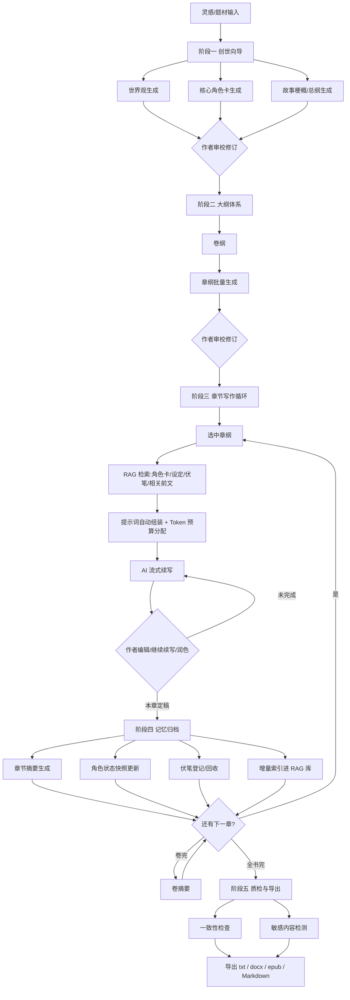

# 产品需求文档（PRD）

## 墨匠 InkCraft —— Windows 端 AI 长篇小说创作软件

| 项目 | 内容 |
|---|---|
| 产品代号 | 墨匠 InkCraft（占位名，正式名称待定） |
| 目标平台 | Windows 10（19044+）/ Windows 11，x64 桌面应用 |
| 文档版本 | V1.0 |
| 撰写日期 | 2026-10-24 |
| 文档状态 | 待评审 |
| 关联文档 | [02-SRS-软件需求规格说明书](02-SRS-软件需求规格说明书.md) · [03-开发设计文档](03-开发设计文档.md) · [04-提示词模板库](04-提示词模板库.md) |

---

## 1. 产品概述

### 1.1 一句话定位

一款运行在 Windows 个人电脑上的 **AI 长篇小说创作工坊**：作者负责创意与终审，软件通过「结构化设定集 + 分层记忆 + RAG 检索」让 AI 在数十万字的长篇创作中始终记得你的世界观、角色和伏笔，实现高质量的大纲生成与正文续写。

### 1.2 产品核心理念

> **人主导创意与审核，AI 负责扩写与记忆。**

三条产品红线：

1. **创作主权在人**：所有 AI 产出均以草稿态呈现，采纳、修改、回滚的权力永远在作者手中。
2. **设定即真相（Single Source of Truth）**：一切 AI 生成以「设定集 + 大纲」为唯一约束，正文与设定冲突时以设定为准并告警。
3. **数据本地主权**：作品数据 100% 存储于用户本机；除用户主动配置的模型 API 调用外，作品内容不出本机。

### 1.3 要解决的用户痛点

| # | 痛点 | 具体表现 | 本产品方案 |
|---|---|---|---|
| 1 | **长篇记忆崩坏** | 用通用 AI 聊天窗写小说，几万字后 AI 忘记设定、人设跑偏、称呼混乱、前后矛盾 | 结构化设定集（Codex）+ RAG 按需检索 + 分层记忆（章节摘要 / 角色状态快照 / 伏笔登记表） |
| 2 | **上下文装不下一本书** | 百万字小说远超模型上下文窗口，作者只能手工复制粘贴"前情提要"，费时且遗漏 | 续写时自动完成「检索 → 组装 → 注入」，作者无感知 |
| 3 | **日更效率压力** | 全职网文作者日更 6000～12000 字，长期高压 | 大纲驱动的批量章纲生成 + 一键续写 / 扩写 / 润色工具链 |
| 4 | **提示词编写门槛** | 作者不懂提示词工程，每次都要重新描述世界观和文风 | 内置 13 套调优模板 + 变量自动填充，模板全部开放编辑 |
| 5 | **数据安全顾虑** | 作品即资产，担心上传云端泄露或被用于训练 | 本地 SQLite 存储、API Key 系统级加密、支持本地模型（Ollama）离线创作 |
| 6 | **AI 味与同质化** | 通用工具产出的文字有明显"AI 腔"，无法直接商用 | 禁用词表 + 文风样本注入 + 网文节奏控制（章末钩子）等提示词工程手段 |

### 1.4 目标用户

以中文网文生态为核心：

- **全职网文作者**：在起点、番茄、晋江等平台签约/全勤，日更压力大，追求"设定不崩、效率翻倍"。
- **兼职与业余作者**：有正职，利用碎片时间创作，缺的是"随时接得上前文"的上下文管理。
- **新手 / 兴趣创作者**：有故事灵感但缺乏大纲能力与文字功底，需要"创世向导 + 大纲生成"降低起步门槛。
- **内容工作室**（V2.0 考虑）：多人多书批量生产，需要模板复用与成本控制。

### 1.5 竞品分析

| 竞品 | 形态 | 优势 | 差距 / 我们的切入点 |
|---|---|---|---|
| NovelCrafter | Web / 桌面（英文） | Codex 设定库概念成熟 | 中文与网文场景不适配；国内访问与支付不便 |
| Sudowrite | Web（英文） | 续写体验好、功能丰富 | 英文导向、订阅贵、无本地数据 |
| 彩云小梦等续写工具 | App / Web | 中文、上手快 | 无结构化设定与长篇记忆，长篇一致性差，产出不可控 |
| 通用大模型对话（ChatGPT / DeepSeek 等） | Web | 模型能力强 | 无项目/章节管理、无持久记忆、提示词每次手写、无法管理百万字上下文 |

**差异化定位**：中文网文垂直优化（题材模板、网文节奏、防 AI 腔）× 本地数据主权 × BYOK 多模型接入 × 完整 RAG 长篇记忆。

### 1.6 商业模式（建议，待定）

- **免费版 + 订阅/买断**：核心编辑器与设定集免费；AI 高级功能（RAG 检索增强、批量章纲、一致性检查）订阅或一次性买断。
- **BYOK（Bring Your Own Key）**：用户自备 API Key，软件不赚模型差价，赚取工具价值。降低运营成本与合规风险。
- 后续可提供官方托管模型套餐（需内容合规审核，V2.0 评估）。

---

## 2. 用户画像

### 画像 A：陈默，28 岁，全职玄幻作者（核心用户）

- 在平台连载 2 本书，日更 8000 字，全勤奖是收入底线。
- 现状：用 Word 写稿 + 网页版 AI 续写，每天花 1 小时整理"前情提要"粘贴给 AI；书超过 60 万字后 AI 频繁写错主角金手指的规则，被读者抓 bug 上评论区。
- 诉求：**AI 记得住设定**；章纲批量生成；续写一次可用率 60% 以上。
- 愿付：买断 200～400 元或年订阅 300 元级别。

### 画像 B：林岚，34 岁，兼职都市文作者

- 白天上班，晚上写 2 小时，周末多写。最痛的是"隔了三天不记得自己写到哪、配角叫什么"。
- 诉求：打开软件即看到"上一章摘要 + 当前章纲 + 待回收伏笔"；断点无缝续写。
- 对数据安全敏感：书稿绝不放云端。

### 画像 C：小舟，21 岁，新手创作者

- 有"末日废土+系统流"的点子，但不会做大纲，写 3 万字就崩盘弃坑。
- 诉求：创世向导一步步帮他把灵感变成世界观、角色、三层大纲；AI 带着他把第一章写出来。

---

## 3. 核心用户旅程（End-to-End）

### 阶段说明

| 阶段 | 名称 | 作者做什么 | AI 做什么 | 软件保障 |
|---|---|---|---|---|
| 一 | 创世 | 输入题材/灵感/风格偏好，审改产出 | 生成世界观、角色卡、故事总纲 | 分步向导，产出进设定集 |
| 二 | 大纲 | 审改、拖拽调整章节顺序 | 三层大纲（总纲→卷纲→章纲），章纲含目标/情节点/出场角色/伏笔/章末钩子 | 大纲结构化存储，与写作联动 |
| 三 | 写作 | 选章纲、下指令、编辑 AI 草稿 | 按 RAG 上下文流式续写、扩写、润色 | 上下文自动组装、Token 预算、提示词透明可查 |
| 四 | 记忆 | 一键（或自动）归档 | 生成本章摘要、更新角色状态、提取伏笔 | 增量索引，防止长篇遗忘 |
| 五 | 质检 | 处理检查报告 | 一致性检查、敏感词扫描 | 报告定位到句，一键跳转修改 |

---

## 4. 功能需求总览（按优先级）

> P0 = MVP 必须；P1 = V1.x 应有；P2 = V2.0 规划。详细验收标准见 SRS。

### 4.1 项目与书架管理

| 编号 | 功能 | 优先级 |
|---|---|---|
| LIB-01 | 书架页：创建/打开/删除/归档书籍项目 | P0 |
| LIB-02 | 书籍元信息：题材、目标字数、文风指令、封面 | P0 |
| LIB-03 | 手动备份与恢复（整库导出/导入 zip） | P1 |
| LIB-04 | 自动云备份（可选，用户自选网盘目录） | P2 |

### 4.2 创世向导

| 编号 | 功能 | 优先级 |
|---|---|---|
| GEN-01 | 分步向导：题材选择（玄幻/都市/悬疑/科幻…模板）→ 灵感描述 → 风格偏好 | P0 |
| GEN-02 | AI 生成世界观设定（力量体系、社会结构、核心规则、禁忌） | P0 |
| GEN-03 | AI 生成主要角色卡（主角/对手/关键配角，含人设、动机、说话风格） | P0 |
| GEN-04 | AI 生成故事梗概与总纲（起承转合、卷级走向） | P0 |
| GEN-05 | 从已有 TXT 大纲/设定文档一键导入解析 | P1 |

### 4.3 设定集（Codex）

| 编号 | 功能 | 优先级 |
|---|---|---|
| CX-01 | 条目 CRUD：角色 / 地点 / 势力 / 物品 / 功法规则 / 自定义类型 | P0 |
| CX-02 | 别名管理（曾用名、昵称、称号）——供检索与正文实体识别 | P0 |
| CX-03 | 角色状态快照：随章节推进记录位置/心境/能力/关系/持有物 | P1 |
| CX-04 | 条目重要性分级：常驻上下文 / 检索注入 | P1 |
| CX-05 | 设定引用检测：正文中出现实体名自动高亮并关联条目 | P2 |

### 4.4 大纲体系

| 编号 | 功能 | 优先级 |
|---|---|---|
| OL-01 | 三层大纲树：总纲 → 卷纲 → 章纲，树形导航 | P0 |
| OL-02 | 章纲卡片字段：目标 / 情节要点 / 出场角色 / 伏笔（埋/收）/ 情绪节奏 / 章末钩子 | P0 |
| OL-03 | AI 生成卷纲；按卷纲批量生成章纲（一次 10～30 章） | P0 |
| OL-04 | 章纲细化：一键把粗纲扩成可写作的细纲 | P1 |
| OL-05 | 拖拽排序、跨卷移动、与正文章节双向关联 | P1 |

### 4.5 章节编辑器

| 编号 | 功能 | 优先级 |
|---|---|---|
| ED-01 | 三栏工作台：左（章节树/大纲）· 中（正文编辑器）· 右（AI 面板/设定集速查） | P0 |
| ED-02 | 富文本编辑：段落、自动保存（≤5 秒防丢稿）、字数统计 | P0 |
| ED-03 | 划词 AI 工具：润色 / 改写 / 扩写 / 缩写（对选中文本操作） | P0 |
| ED-04 | AI 续写：光标处一键续写，流式输出，可中断/回退 | P0 |
| ED-05 | 版本快照：每次 AI 生成前保存快照，支持 diff 对比与回滚 | P0 |
| ED-06 | 多版本草稿对比（AI 稿 A/B 对比采纳） | P2 |
| ED-07 | 灵感便签 / 待办（不进入正文） | P2 |

### 4.6 AI 生成与模型管理

| 编号 | 功能 | 优先级 |
|---|---|---|
| AI-01 | 多供应商接入：OpenAI 兼容协议（DeepSeek / GLM / Kimi / 通义 / OpenAI…）+ Ollama 本地模型 | P0 |
| AI-02 | 模型分工配置：创世用 A 模型、续写用 B 模型、摘要用便宜模型（成本优化） | P0 |
| AI-03 | 流式输出、任务队列、失败重试、断线恢复 | P0 |
| AI-04 | 用量统计：按书/按功能统计 token 与费用估算 | P1 |
| AI-05 | 提示词模板中心：内置模板查看、编辑、另存、恢复默认 | P0 |
| AI-06 | 「透明度」：每次生成可查看实际发送的完整提示词与检索命中明细 | P1 |

### 4.7 RAG 上下文引擎（核心差异化）

| 编号 | 功能 | 优先级 |
|---|---|---|
| RG-01 | 多源索引：设定条目 / 章节正文（按场景切片）/ 章节摘要 / 卷摘要 / 伏笔 / 角色状态 | P0 |
| RG-02 | 混合检索：向量语义检索 + 关键词检索（专有名词精确命中），中文友好 | P0 |
| RG-03 | 上下文组装器：按 Token 预算表自动装配各区块，超限自动降级裁剪 | P0 |
| RG-04 | 增量索引：章节保存/归档时后台更新，无需全量重建 | P0 |
| RG-05 | 嵌入双模式：API 嵌入（如 embedding-3）或本地嵌入（bge-small-zh 离线推理） | P1 |
| RG-06 | 检索调试面板：给定查询查看命中与得分（供高级用户与排障） | P2 |

### 4.8 记忆系统

| 编号 | 功能 | 优先级 |
|---|---|---|
| MEM-01 | 章后一键归档：生成本章摘要（200～400 字） | P0 |
| MEM-02 | 角色状态更新：从本章正文提取各角色最新状态，形成按章节的快照链 | P1 |
| MEM-03 | 伏笔登记表：提取/手工登记伏笔，状态机（埋设→呼应→回收→废弃），写作时自动提醒 | P1 |
| MEM-04 | 卷摘要 / 全书梗概自动滚动更新 | P1 |
| MEM-05 | 时间线事件表（可选维护） | P2 |

### 4.9 质检与导出

| 编号 | 功能 | 优先级 |
|---|---|---|
| QA-01 | 一致性检查：人设一致性 / 设定冲突 / 时间线矛盾 / 伏笔超期未收，输出定位报告 | P1 |
| QA-02 | 敏感内容检测：本地词库扫描（发布平台合规），可自定义词库 | P1 |
| QA-03 | 导出：txt（按平台规范分段）、docx、Markdown；epub | P0（epub 为 P1） |
| QA-04 | 起名器：人名 / 地名 / 功法名（含查重，避免与已有设定冲突） | P2 |

### 4.10 设置

| 编号 | 功能 | 优先级 |
|---|---|---|
| ST-01 | API Key 管理（Windows 凭据加密存储）、连通性测试 | P0 |
| ST-02 | 生成参数默认值：温度、max tokens、续写字数 | P0 |
| ST-03 | 界面主题（浅色/深色/护眼）、编辑器字体行距 | P1 |
| ST-04 | 数据目录位置自定义 | P1 |

---

## 5. 关键用户故事（精选）

- **US-01（续写）**：作为全职作者，我在第 217 章点击"续写"时，希望 AI 自动带上本章章纲、出场角色的最新状态、前 3 章摘要、未回收伏笔和最近的正文衔接段，**不需要我手工整理任何前情**，产出一接得上、不违背设定的 1000 字草稿。
- **US-02（防崩设定）**：作为作者，当 AI 续写内容让"已废武功"的角色使用了武功时，我希望一致性检查能标出这一句并给出设定依据，而不是等读者发现。
- **US-03（批量大纲）**:作为效率型作者，我希望选定卷纲后一次生成 20 章的章纲草稿，我在卡片视图上逐条改完再开始写作。
- **US-04（断点恢复）**：作为兼职作者，三天没打开软件，重新打开时希望看到"上次写到哪 + 下一章要写什么"的接续面板。
- **US-05（成本可控）**：作为 BYOK 用户，我希望看到每本书花了多少 token、折合多少钱，并能给续写设置"单次请求预算上限"。
- **US-06（提示词主权）**：作为进阶用户，我希望编辑内置续写模板（例如加入自己的禁用词表），并保留版本可回滚。

---

## 6. 非功能性需求概述

| 类别 | 要求摘要（详见 SRS 第 5 章） |
|---|---|
| 性能 | 续写首字延迟 < 3s（API 正常时）；10 万字项目检索 < 500ms；100 万字项目编辑不卡顿；启动 < 5s |
| 可靠性 | 自动保存间隔 ≤ 5s；AI 生成中断不丢已完成段落；数据库单写多读 + WAL |
| 安全 | API Key 使用 Windows DPAPI 加密；作品数据仅在本地；网络请求仅指向用户配置的模型端点 |
| 兼容 | Win10 19044+ / Win11 x64；DPI 缩放 100%～200% |
| 隐私合规 | 明示"内容将发送至你配置的模型服务"；本地模型模式全程离线 |
| 可维护性 | 提示词模板、禁用词表、敏感词库均为数据文件，可热更新 |

---

## 7. 版本规划

| 版本 | 周期 | 范围 |
|---|---|---|
| **V1.0 MVP** | ~3 个月 | 书架/项目管理、创世向导、设定集（基础）、三层大纲、三栏编辑器、AI 续写（含 RAG 组装 + Token 预算）、划词润色/扩写、章后摘要归档、导出 txt/docx、多供应商模型接入、提示词模板中心 |
| **V1.1～1.5** | +2 个月 | 角色状态快照、伏笔登记表与提醒、一致性检查、敏感词检测、用量统计、备份恢复、epub 导出、检索调试面板、本地嵌入模型 |
| **V2.0** | 规划中 | Ollama 深度集成（模型管理 GUI）、剧情多分支管理（IF 分支树）、起名器、设定引用高亮、Mac 版评估、协作/工作室版评估 |

**MVP 取舍原则**：先跑通「创世 → 大纲 → 续写 → 归档 → 导出」主链路并保证续写质量；一致性与高级记忆功能后置——因为没有可靠 RAG 上下文的一致性检查是无本之木。

---

## 8. 成功指标（V1.0 上线后 3 个月）

| 指标 | 目标 | 说明 |
|---|---|---|
| 续写采纳率 | ≥ 50% | AI 产出字数中被保留进正文的占比（本地统计） |
| 单章人工耗时下降 | ≥ 40% | 对比用户自述基线（新用户引导采集） |
| 长篇一致性 | 设定冲突类人工反馈 < 1 次 / 10 万字 | 以一致性检查报告命中率间接衡量 |
| 丢稿事故 | 0 | 自动保存 + 快照机制 |
| 7 日创作留存 | ≥ 40% | 打开软件且有写作行为（本地埋点，可选上报） |

---

## 9. 风险与应对

| 风险 | 等级 | 应对 |
|---|---|---|
| 模型 API 成本/限流波动 | 高 | 多供应商自动切换；模型分工（摘要用廉价模型）；预算上限；Ollama 本地兜底 |
| 长文本质量随字数衰减 | 高 | 分层记忆压缩（章→卷→书摘要链）；RAG 只注入相关信息而非堆料 |
| AI 腔 / 同质化 | 中 | 禁用词表 + 文风样本（用户可投喂自己已发布章节）+ 温度与提示词调优 |
| 平台内容合规 | 中 | 本地敏感词库扫描；导出前置检查提醒；不提供官方云端生成（V1） |
| 嵌入模型中文效果 | 中 | 默认 API 嵌入（中文优化模型），本地模式选型 bge-small-zh；RAG 评测集持续验证召回率 |
| Electron 内存占用被诟病 | 低 | V1 用 Electron 保证开发效率；架构上隔离核心逻辑（纯 TS 包），为未来迁移 Tauri 留余地 |

---

## 10. 评审记录

| 日期 | 版本 | 评审人 | 结论 | 备注 |
|---|---|---|---|---|
| 2026-10-24 | V1.0 | — | 待评审 | 初稿 |
