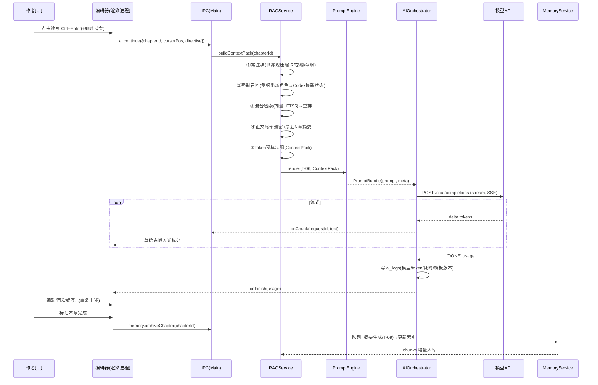

# 开发设计文档（DDD）

## 墨匠 InkCraft —— Windows 端 AI 长篇小说创作软件

| 项目 | 内容 |
|---|---|
| 文档版本 | V1.0 |
| 撰写日期 | 2026-10-24 |
| 依据文档 | [01-PRD](01-PRD-产品需求文档.md) · [02-SRS](02-SRS-软件需求规格说明书.md) · [04-提示词模板库](04-提示词模板库.md) |

---

## 1. 技术选型

| 层 | 选型 | 版本基线 | 理由与备选 |
|---|---|---|---|
| 桌面框架 | **Electron** | 33+ | Node 侧 AI/数据库生态最全（openai sdk、better-sqlite3、onnxruntime-node）；流式 UI 成熟；团队上手快。备选 Tauri 2（包体小、内存低，但 Rust 侧生态与开发速度是成本，V2 再评估迁移——核心逻辑已隔离为纯 TS 包） |
| 前端 | React 18 + TypeScript + Vite | — | 生态与招聘最容易 |
| 状态管理 | Zustand | 5 | 轻量、无样板代码 |
| 编辑器 | TipTap（ProseMirror） | 3 | 支持自定义节点（草稿态标记）、划词菜单、协同扩展预留 |
| 本地库 | SQLite（better-sqlite3，WAL） | — | 单文件、可靠、嵌入与全文检索一体化 |
| 向量检索 | **sqlite-vec** 扩展 | 0.1.x | 与 SQLite 同库零运维；50 万 chunk 级完全够用。备选 LanceDB（如需更大规模） |
| 关键词检索 | SQLite FTS5 + trigram tokenizer | — | trigram 对中文子串匹配友好（角色名/地名精确命中是刚需） |
| 嵌入 | 双模式：API（OpenAI 兼容 /v1/embeddings）或本地 ONNX（bge-small-zh-v1.5，512 维） | — | 本地模式经 onnxruntime-node 推理，离线可用；API 模式效果更稳 |
| LLM 接入 | 自研薄适配层（OpenAI 兼容 chat/completions + SSE） | — | 不引重 SDK，统一重试/限流/取消；天然支持 DeepSeek/GLM/Kimi/Qwen/OpenAI/Ollama |
| Token 计数 | js-tiktoken（cl100k 估算）+ 中文按字折算兜底 | — | 组装预算用，允许 ±10% 误差，发送前二次校验 |
| 进程通信 | Electron IPC（typed channels） | — | 见第 8 章 |
| 打包 | electron-builder（NSIS） | — | Win 签名与自动更新（更新默认手动检查） |

**其他约定**：monorepo（pnpm workspace）；ESLint + Prettier；Vitest 单测 + Playwright E2E；TypeScript strict。

---

## 2. 系统架构

```mermaid
flowchart TB
    subgraph R[渲染进程 React UI]
        UI1[书架/创世向导]
        UI2[三栏工作台: 章节树 | TipTap编辑器 | AI面板]
        UI3[设定集 Codex]
        UI4[大纲编辑]
        UI5[模板中心/设置]
    end

    subgraph M[主进程 Main]
        PS[ProjectService 项目/卷/章 CRUD]
        OS[OutlineService 大纲]
        CS[CodexService 设定集]
        MS[MemoryService 摘要/状态/伏笔]
        AO[AIOrchestrator<br/>任务队列/流式/重试/日志]
        PE[PromptEngine<br/>模板渲染/Token预算]
        RG[RAGService<br/>切片/嵌入/索引/混合检索/组装]
        ES[ExportService 导出]
        ST[SettingService/Keyring]
    end

    subgraph D[数据层]
        DB[(SQLite WAL<br/>表 + FTS5 + sqlite-vec)]
        FS[文件系统<br/>备份/快照/导出/资源]
    end

    subgraph E[外部]
        LLM[模型 API<br/>OpenAI 兼容]
        EMB[嵌入 API / 本地 ONNX]
    end

    R <-->|typed IPC| M
    PS & OS & CS & MS & ES --> DB
    PS --> FS
    AO --> PE
    PE --> RG
    RG --> DB
    RG --> EMB
    AO <--> LLM
    MS --> AO
    ES --> FS
    ST --> DB
```

**分层原则**：

1. `packages/core`（纯 TS，无 Electron 依赖）：RAG 管线、PromptEngine、切片器、Token 预算器、领域模型 —— **可独立单测，未来可迁 Tauri**。
2. `apps/desktop`：Electron 壳 + IPC + 服务装配 + 持久化实现。
3. UI 不直接触碰数据；一切经 IPC。

---

## 3. 目录结构（monorepo）

```
inkcraft/
├─ apps/desktop/                 # Electron 应用
│  ├─ src/main/                  # 主进程
│  │  ├─ services/               # Project/Outline/Codex/Memory/RAG/Export/Setting 装配
│  │  ├─ ipc/                    # typed IPC 注册（第 8 章接口）
│  │  ├─ db/                     # better-sqlite3 初始化、迁移、FTS5/vec 扩展加载
│  │  └─ windows/                # 窗口管理
│  ├─ src/preload/               # contextBridge 暴露安全 API
│  └─ src/renderer/              # React UI
│     ├─ features/               # library/genesis/codex/outline/editor/settings/templates
│     ├─ components/
│     └─ stores/                 # zustand
├─ packages/core/                # 纯 TS 核心逻辑（无 Electron 依赖）
│  ├─ src/rag/                   # chunker.ts / embedder.ts / retriever.ts / assembler.ts
│  ├─ src/prompt/                # engine.ts / budget.ts / templates（内置模板 seed）
│  ├─ src/memory/                # summarizer.ts / stateExtractor.ts
│  ├─ src/ai/                    # provider.ts（OpenAI 兼容客户端）/ queue.ts
│  └─ src/domain/                # 实体类型与校验（zod）
├─ packages/shared/              # 渲染/主进程共享类型（IPC 契约）
└─ resources/                    # 禁用词表/敏感词库/题材模板/内置提示词 seed
```

---

## 4. 关键流程：章节写作主循环（时序）



---

## 5. 数据模型

单书单库（`<bookId>.db`），书架索引库 `library.db` 记录所有书。核心表：

```sql
-- ============ 业务表 ============
CREATE TABLE projects (
  id TEXT PRIMARY KEY, title TEXT NOT NULL,
  genre TEXT, target_words INTEGER,
  style_guide TEXT,            -- 文风指令(注入续写提示词)
  pov TEXT DEFAULT '第三人称单视角',
  banned_words TEXT,           -- 全书禁用词(逗号分隔,拼接进提示词)
  model_config TEXT,           -- JSON: 各场景模型/provider 映射
  created_at INTEGER, updated_at INTEGER
);

CREATE TABLE volumes (
  id TEXT PRIMARY KEY, project_id TEXT NOT NULL,
  no INTEGER, title TEXT, summary TEXT,
  FOREIGN KEY(project_id) REFERENCES projects(id)
);

CREATE TABLE chapters (
  id TEXT PRIMARY KEY, project_id TEXT NOT NULL, volume_id TEXT,
  no INTEGER,                 -- 全书连续章号(检索邻近性依赖此字段)
  title TEXT, content TEXT DEFAULT '',
  word_count INTEGER DEFAULT 0,
  status TEXT DEFAULT 'draft',-- draft/generating/done
  archived_at INTEGER,        -- 章后归档时间(NULL=未归档)
  updated_at INTEGER
);
CREATE INDEX idx_chapters_no ON chapters(project_id, no);

CREATE TABLE outline_nodes (
  id TEXT PRIMARY KEY, project_id TEXT NOT NULL,
  volume_id TEXT, chapter_no INTEGER,   -- 关联章号(章纲层)
  level TEXT NOT NULL,                  -- book/volume/chapter
  title TEXT,
  goal TEXT,                            -- 本章目标
  plot_points TEXT,                     -- JSON: string[]
  character_ids TEXT,                   -- JSON: codex id[](强制召回依据)
  foreshadow_plant TEXT,                -- JSON: 要埋的伏笔描述[]
  foreshadow_payoff TEXT,               -- JSON: 要回收的伏笔id[]
  emotion TEXT, ending_hook TEXT,       -- 情绪节奏 / 章末钩子
  status TEXT DEFAULT 'confirmed'       -- pending(批量生成待确认)/confirmed
);

CREATE TABLE codex_entries (
  id TEXT PRIMARY KEY, project_id TEXT NOT NULL,
  type TEXT NOT NULL,          -- world/character/location/faction/item/rule/custom
  name TEXT NOT NULL,
  aliases TEXT,                -- JSON: string[] ← 别名是检索召回关键
  content TEXT,                -- Markdown 正文
  importance TEXT DEFAULT 'retrieval',  -- pinned(常驻)/retrieval(检索)
  embedding_status TEXT DEFAULT 'dirty',
  updated_at INTEGER
);
CREATE INDEX idx_codex_type ON codex_entries(project_id, type);

-- 角色状态快照(V1.x 启用,V1.0 建表预留)
CREATE TABLE codex_states (
  id TEXT PRIMARY KEY, entry_id TEXT NOT NULL,
  chapter_no INTEGER NOT NULL,           -- 状态生效于该章之后
  state TEXT NOT NULL,                   -- JSON: {位置,心境,能力,关系,持有物,伤势}
  created_at INTEGER,
  UNIQUE(entry_id, chapter_no)
);

CREATE TABLE summaries (
  id TEXT PRIMARY KEY, project_id TEXT NOT NULL,
  chapter_no INTEGER, volume_id TEXT,    -- 二选一: 章摘要/卷摘要
  level TEXT NOT NULL,                   -- chapter/volume/book
  content TEXT NOT NULL, created_at INTEGER
);

CREATE TABLE foreshadowings (
  id TEXT PRIMARY KEY, project_id TEXT NOT NULL,
  description TEXT NOT NULL,
  planted_chapter INTEGER,
  status TEXT DEFAULT 'open',            -- open/echoed/resolved/abandoned
  due_hint TEXT,                         -- 预期回收点(如"第三卷末")
  created_at INTEGER
);

-- 版本快照(存差异)
CREATE TABLE snapshots (
  id TEXT PRIMARY KEY, chapter_id TEXT NOT NULL,
  kind TEXT,                             -- before_ai/manual/before_polish
  base_snapshot_id TEXT, diff_text TEXT, -- 与基快照的差异
  created_at INTEGER
);

-- ============ AI 与模板 ============
CREATE TABLE prompt_templates (
  id TEXT PRIMARY KEY, code TEXT NOT NULL,   -- T-01..T-13(见模板库)
  name TEXT, content TEXT NOT NULL,
  variables TEXT,                        -- JSON: 声明的变量(校验用)
  version INTEGER DEFAULT 1, is_builtin INTEGER DEFAULT 0,
  updated_at INTEGER, UNIQUE(code, version)
);

CREATE TABLE ai_logs (
  id TEXT PRIMARY KEY, request_id TEXT,
  template_code TEXT, model TEXT, provider TEXT,
  prompt_tokens INTEGER, completion_tokens INTEGER,
  latency_ms INTEGER, status TEXT, error TEXT,
  context_meta TEXT,                     -- JSON: 各区块token/检索命中明细(透明度功能)
  created_at INTEGER
);

-- ============ RAG(见第 7 章) ============
CREATE TABLE chunks (
  id TEXT PRIMARY KEY, project_id TEXT NOT NULL,
  source_type TEXT NOT NULL,   -- codex/chapter_text/summary/foreshadow
  source_id TEXT NOT NULL,
  chapter_no INTEGER,          -- 正文块: 来源章号(邻近性加权)
  text TEXT NOT NULL,
  token_count INTEGER,
  entities TEXT,               -- JSON: string[](本块出现的实体名,含别名)
  vec_dirty INTEGER DEFAULT 1, -- 0=已嵌入
  updated_at INTEGER
);
CREATE INDEX idx_chunks_src ON chunks(source_type, source_id);
CREATE VIRTUAL TABLE chunks_fts USING fts5(text, chunk_id UNINDEXED, tokenize='trigram');
CREATE VIRTUAL TABLE chunks_vec USING vec0(embedding float[512]); -- 维度随嵌入模型
```

> 迁移策略：`user_version` + 顺序迁移脚本；升级 seed 内置模板时**不覆盖**用户已修改的模板（按 `is_builtin` + 版本比较，提示用户可选更新）。

---

## 6. 核心模块设计

### 6.1 AIOrchestrator（AI 编排器）

职责：请求生命周期、队列、流式转发、重试、用量统计。

```
任务模型: AiTask { id, bookId, scene: 'genesis'|'outline'|'continue'|'polish'|'extract',
                   model, prompt, maxTokens, temperature, onChunk, signal }
队列规则: 同书串行(保证上下文一致性), 全局并发 ≤2; 任务持久化(ai_task 表)→崩溃恢复
流式:     fetch + ReadableStream 解析 SSE; 每 delta 转发渲染进程(节流 30ms 批量)
重试:     连接类错误(超时/5xx/429)自动重试 ≤2 次指数退避(1s/4s);
          生成中途断流不整单重试,保留已收内容→UI 标记"已中断,可续传"
取消:     AbortController; 队列中任务直接移除
Provider: 统一配置 {name, baseUrl, apiKey(经 SettingService 解密), models[]};
          连通性测试 = GET /models
费用估算: 按模型单价表(resources/pricing.json,可更新) × usage 汇总
```

### 6.2 PromptEngine（提示词引擎）

- 模板渲染：`{{var}}` 替换 + `{{#if var}}...{{/if}}` 条件块；未知变量在保存模板时告警；
- 变量来源：ContextPack（见 7.4）+ 请求参数（字数/视角/指令）+ 书级配置（文风/禁用词）；
- **Token 预算器（budget.ts）**：
  1. 输入：模型上下文窗口、预留输出（默认 4096）、各区块候选内容；
  2. 按预算表（7.4）从 P0→P2 逐块装配，P2 超限裁剪（按检索得分降序丢弃整块，保证不截断句子）；
  3. 输出 PromptBundle + `context_meta`（区块明细，供透明度面板）；
- 发送前二次校验：`estimate(prompt) > window*0.95` → 触发降级重装配（压 P2 → 压 P1 摘要条数）。

### 6.3 MemoryService（记忆系统）

```
章后归档 pipeline(后台队列,不阻塞写作):
  ① T-09 摘要: 输入本章正文+章纲 → 200~400字事实型摘要 → summaries(chapter)
  ② V1.x: T-10 角色状态提取 → 与上一快照 diff → codex_states
  ③ V1.x: T-11 伏笔提取 → foreshadowings 登记(人工确认)
  ④ 全部完成 → RAGService.reindex(chapter) 增量索引
摘要链: 章摘要(写作时取最近N条) + 卷摘要(卷完成时滚动更新)
        未来全书>50万字时增加"每10万字阶段摘要"层(预留 level=stage)
```

**角色状态查询规则**：写作第 N 章时，取 `codex_states WHERE entry_id=? AND chapter_no < N ORDER BY chapter_no DESC LIMIT 1`，即"截至上一章的最新状态"，保证续写不会让死人复活、废人用功。

### 6.4 ExportService / 其他

导出：内存流式拼接 → docx 用 `docx` 库（标题样式映射卷/章）；txt 按平台规范（章节标题行+空行）；导出任务不阻塞 UI。备份：整库文件复制 + WAL checkpoint，zip 存储。

---

## 7. RAG 管线（核心设计）

### 7.1 索引数据源分层

| 源 | source_type | 切片粒度 | 元数据 | 更新时机 |
|---|---|---|---|---|
| Codex 条目 | codex | 每条目一片 | entities=名称+别名 | 条目保存（防抖 10s） |
| 章节正文 | chapter_text | **按场景切片** 400~800 字，重叠 50~100 | chapter_no、entities | 章节保存（防抖 30s，dirty 标记） |
| 章节摘要 | summary | 每条一片 | chapter_no | 归档完成 |
| 卷摘要 | summary | 每条一片 | volume | 卷摘要生成 |
| 伏笔 | foreshadow | 每条一片 | planted_chapter | 登记/状态变更 |

**场景切片算法（chunker.ts）**：优先按场景边界切——空行分段聚合成"段组"；检测场景转换信号（时间跳转词"第二天/三天后"、地点介词短语开头、视角人物切换）；单块超 800 字再按段落硬切并保留重叠；每块跑实体词典匹配（Codex 全部名称+别名的 Aho-Corasick 自动机）写入 `entities`。

### 7.2 嵌入（embedder.ts）

- API 模式：`POST /v1/embeddings`，批量 ≤ 64 片/次，速率限制 429 退避；`vec_dirty=1 → 0`；
- 本地模式：onnxruntime-node 加载 bge-small-zh-v1.5（int8 量化，~30MB），批量推理；首次初始化在后台线程，不阻塞启动；
- 嵌入模型不可混用：模型指纹（model id/维度）存库，切换模型触发"重建向量索引"向导。

### 7.3 混合检索与重排（retriever.ts）

**查询构造（续写场景，三路查询）**：

```
Q1 实体查询 = 章纲.character_ids → 角色卡(不走相似度,强制召回)
             + 章纲/正文尾部命中的实体名 → 对应 Codex 卡片(强制)
Q2 语义查询 = 章纲.goal + plot_points 拼接 + 场景关键词 → 向量检索(chapter_text/summary/foreshadow)
Q3 关键词查询 = 实体名+别名+情节点关键词 → FTS5 trigram 检索
```

**融合与重排**：

```
score(chunk) = 0.60 * cosine_norm + 0.40 * fts_bm25_norm
boost:       +0.10  if chapter_no ∈ [当前章-5, 当前章-1]   (邻近情节更相关)
             +0.05  if source_type == 'summary'            (摘要信息密度高)
             ×0.6^floor((当前章-chapter_no)/50)  仅对 chapter_text(远章正文衰减,设定/摘要不衰减)
强制规则:    章纲出场角色卡必选; 查询命中实体对应 codex 必选;
            status='open' 的伏笔(与本章章纲 foreshadow_payoff 匹配)必选
去重合并:    同 source_id 相邻 chunk 合并为一块; 每章最多取 2 块正文(防单章刷屏)
产出:        List<Chunk>{text, source, score, reason} + 剩余交给预算器裁剪
```

**关键设计决策**：小说检索与通用 RAG 的差异——**专有名词必须精确命中**（角色写错名字是事故），故关键词通道与实体强制召回是正确性保障；向量通道负责"语义相关情节"（如三年前的类似事件）。两者缺一不可。

### 7.4 Token 预算表与上下文组装（assembler.ts）

以「32K 输入预算 / 4K 预留输出」为标准档；8K/16K/128K 档按比例缩放 P2/P1 区块。

| 优先级 | 区块 | 内容 | 标准预算(token) | 裁剪策略 |
|---|---|---|---|---|
| P0 | 系统指令 | 角色+铁律+禁用词 | 800 | 不可裁 |
| P0 | 世界观压缩卡 | Codex pinned 条目压缩版 | 1200 | 不可裁 |
| P0 | 本卷纲要 | 卷纲摘要 | 800 | 不可裁 |
| P0 | 本章章纲 | 全字段 | 600 | 不可裁 |
| P0 | 出场角色卡 | ≤4 个，含最新状态快照 | 1600 | 按章纲顺序保留前 4，其余丢弃 |
| P0 | 正文尾部 | 滑动窗口（续写锚点） | 2500 | 不可裁 |
| P0 | 用户即时指令 | — | 300 | 不可裁 |
| P1 | 最近章摘要 | 最近 3 章 | 1200 | 3→2→1 章递减 |
| P1 | 伏笔清单 | open 状态 | 500 | 仅 open |
| P2 | RAG 补充设定 | Q1/Q3 命中 | 1500 | 按得分降序整块丢弃 |
| P2 | RAG 相关前文 | Q2 命中 | 1800 | 按得分降序整块丢弃 |
| — | **合计** | | **≈12.8K** | 8K 档砍半 P2；128K 档 P2×3 |

组装产出 `ContextPack` → PromptEngine 渲染 T-06 → 请求。`context_meta` 记录每区块实际 token、命中来源与得分（透明度面板数据源）。

### 7.5 检索质量评测（持续）

`packages/core/src/rag/__tests__/evalset/`：样例书（10 万字，自产）+ ≥50 条标注查询（"续写第 87 章时应召回什么"）。CI 阶段跑召回率@5，门槛 80%；改切片/检索参数必须过评测（防回归）。

---

## 8. IPC 接口契约（typed channels）

| Channel | 方向 | 请求 → 响应 | 说明 |
|---|---|---|---|
| `project:list/create/open/rename/delete/archive` | invoke | ProjectDTO[] / ProjectDTO | 书架 |
| `chapter:get/save/list/moveUp/moveDown/markDone` | invoke | ChapterDTO | 保存防抖在渲染层，落库在 Main |
| `outline:generateVolume/generateBatch/refine/save/confirm` | invoke+event | OutlineNodeDTO[] | 批量生成走事件推送进度 |
| `codex:crud/mergeAlias/search` | invoke | CodexEntryDTO | — |
| `ai:continue/polish/expand/rewrite/generate(genesis)` | invoke+event | requestId → 流式 `ai:onChunk/{id}`、`ai:onFinish/{id}`、`ai:onError/{id}` | 统一走编排器 |
| `ai:cancel` | invoke | requestId | AbortController |
| `ai:getPromptPreview` | invoke | requestId → 完整提示词 | 透明度 |
| `rag:search/rebuild/status` | invoke | 命中列表 / 进度事件 | 调试与重建 |
| `memory:archiveChapter/retry` | invoke | — | 归档队列 |
| `export:run` | invoke | 文件路径 | — |
| `settings:get/save/testProvider/decryptKey` | invoke | — | Key 仅存取不外传渲染层明文 |
| `snapshot:list/restore/preview` | invoke | — | — |

事件统一 `on(channel, listener)`，渲染层经 preload 暴露的 typed API 调用（禁用 nodeIntegration，启用 contextIsolation）。

---

## 9. 开发里程碑（建议 20 周 / 1～2 人全职 + AI 辅助编码）

| 里程碑 | 周期 | 交付 | 验收要点 |
|---|---|---|---|
| **M1 骨架** | W1–4 | 工程搭建、书架/项目/卷/章 CRUD、TipTap 编辑器（自动保存/字数统计）、设置+Provider 配置+连通测试、SQLite 迁移框架 | 能建书写字不丢稿 |
| **M2 AI 基线** | W5–8 | AIOrchestrator（队列/流式/重试/日志）、PromptEngine V1、基础续写（无 RAG：仅正文尾部+手动前文）、划词润色/扩写、快照与回滚 | 端到端续写可用；透明度面板雏形 |
| **M3 设定与大纲** | W9–13 | 创世向导、Codex CRUD+别名、三层大纲+批量章纲、模板中心 | 创世→大纲链路完整；模板可编辑 |
| **M4 RAG 与记忆** | W14–17 | 切片/嵌入/索引/混合检索/预算组装接入续写、章后摘要归档、增量索引、导出 txt/docx | 评测集召回率@5≥80%；10 万字书续写一致性人工评审通过 |
| **M5 打磨发布** | W18–20 | 100 万字压测与性能优化、安装包+签名、首启引导、文档、灰度渠道 | SRS 第 7 章验收门槛全过 |

每个里程碑结束做一次"自用日"：团队用当前版本真实写 3 章小说，记录摩擦点进下个迭代。

---

## 10. 测试策略

| 层 | 对象 | 工具/方法 | 关键用例 |
|---|---|---|---|
| 单元 | chunker 场景切片、budget 裁剪、模板渲染、混合得分、状态快照查询 | Vitest | 边界：800 字硬切、8K 预算降级、别名命中、{{#if}} 嵌套 |
| 集成 | 检索召回率评测集、IPC 契约、迁移脚本 | Vitest + 内存 SQLite | 召回@5≥80%；旧库升级无损 |
| E2E | 创世→大纲→续写→归档→导出全链路 | Playwright（Electron） | 断流续传；崩溃恢复队列 |
| 性能 | 100 万字压测脚本 | 自建基准 | SRS 5.1 全指标 |
| 人工 | AI 产出质量（AI 味/一致性） | 评审清单 | 抽样 20 章盲评 |

---

## 11. 风险与技术债管理

| 风险 | 缓解 |
|---|---|
| sqlite-vec 在大规模 chunk 下的性能 | 50 万 chunk 压测提前到 M4 第一周；不行则切 LanceDB（core 包隔离了 retriever 接口） |
| 本地嵌入模型内存占用 | 懒加载+可卸载；默认 API 模式 |
| Electron 安全（XSS 注入正文） | contextIsolation、正文按纯文本/受限 Markdown 渲染、CSP |
| 模型输出格式漂移（JSON 解析失败） | 提取类任务用宽松解析（正则截取 JSON 主体）+ 失败重试换提示 |
| 中文 token 估算误差 | 发送前二次校验 + 5% 安全余量 |

---

## 12. 修订记录

| 日期 | 版本 | 说明 |
|---|---|---|
| 2026-10-24 | V1.0 | 初稿 |
